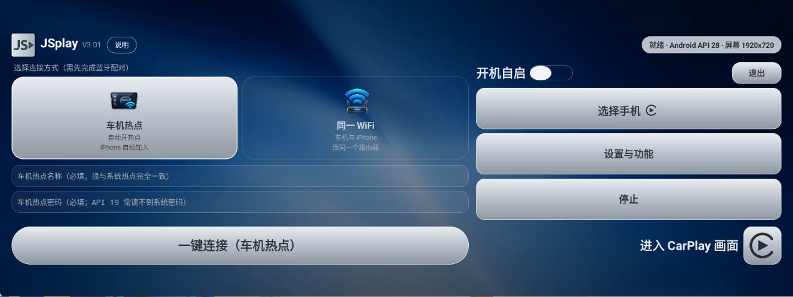

# JSPLAY（本地修改版）

> 说明：本仓库是 jszm2026 基于 [DiPlay](https://github.com/shihabal3amri/DiPlay) 与 [xcertplay](https://github.com/shilapi/xcertplay) 的本地修改版本。上游代码分别采用 AGPL-3.0 / GPL-3.0 许可证，修改和再分发请遵守原许可证并保留署名，详见 [第三方声明](docs/THIRD_PARTY_NOTICES.md)。本仓库不包含任何 accessory 凭据、Android 签名密钥、APK 或设备配对数据。

**A CarPlay port custom-built for French cars (Peugeot/Citroen) with Hangsheng "big blue screen" head units** - especially the Citroen C5 X. Wired and wireless, with the familiar DiAuto interface. Independent app: `com.shihab.diplay`.

The hardest part, the **Bluetooth handshake**, took nearly two months to solve. Steering-wheel control support for the Citroen C5 X on Hangsheng hardware is already integrated. Audio routing and CarPlay video streaming are still being refined; **TCP currently runs on port 7000**. Contributions toward a smoother port are welcome.

> **Scope of this repository:** The offline authentication module is private property and is **not included** here. We publish the methods and interfaces only, so developers who understand the stack can build an implementation that fits their own vehicle and setup. The `LocalMfiAuthenticationClient` in the source tree is an interface-contract example; it ships with no real identity or credential files, and a working identity must be supplied by the developer. No installation package, signing key or accessory identity is distributed.

> **Support scope:** Purpose-built for French cars (Peugeot/Citroen) with Hangsheng big-blue-screen head units, especially the Citroen C5 X. Other vehicles are untested and unsupported; there are no plans to add brand-specific support.

[Website](https://jszm2026.github.io/jsplay-diplayforCitro-nC5X/) · [Build from source](docs/BUILD.md) · [Report a problem](https://github.com/jszm2026/jsplay-diplayforCitro-nC5X/issues/new/choose)

## JSplayV1.62 — public preview

Install on the **car**, not the iPhone. No jailbreak, dongle, Mac, account or authentication server is required for use. Core CarPlay does not require ADB; optional dashboard, battery, wheel-speed and parked-video features do. Your head unit must permit APK installation. Built for **Android 4.4.3 (API 19) Hangsheng blue-screen head units** in French Peugeot/Citroen cars. Wireless uses the car's existing hotspot or same-Wi-Fi mode.

- Wired USB and wireless CarPlay with local authentication.
- BYD HUD navigation with arrows, distance and street names on verified firmware.
- Car hotspot support, improved audio buffering and saved receive diagnostics.
- Automatic address discovery, fixed-channel Wi-Fi fallbacks and successful-configuration memory.
- Icon/text size, resolution and frame rate; applying a display change reconnects CarPlay.
- Local diagnostic export. Reports are sent only if you choose to share them.
- Separate installation alongside DiAuto. Run one projection app at a time.

Current build: `JSplayV1.62` (versionCode 62, package `com.jsplay.com`).

This is **not an Apple-certified product**. Release builds may bundle an experimental accessory identity supplied by the local release process; a bundled private key is extractable. Acceptance after future iOS updates, reliability across head units and suitability of that identity for general distribution are unresolved. This release invites community testing; it is not a guarantee of universal compatibility.

Earlier upstream notes describe tests on a development DiLink5.1 car: live windshield guidance and street names work, Car hotspot now starts CarPlay, and Wi-Fi Direct performance is substantially improved. Occasional audio cutouts remain and are deferred to a later update. The floating-map test build was installed on the development DiLink 5.1 car; feedback led to the pinch corrections in 0.2.9. Earlier wheel-speed and video contributions were tested on a BYD Tang with DiLink 5.0 and an iPhone 15 Pro on iOS 27; wheel-speed dead reckoning in tunnels remains unverified. Broader head-unit and iOS compatibility is not guaranteed. The HUD firmware scope and cleanup limits are documented in [BYD navigation](docs/BYD_NAVIGATION.md).

## What’s new in this build

- CarPlay song metadata, playback position and album artwork for compatible Android launchers and media displays.
- Available-port selection when another service occupies AirPlay port 7000, with the selected port advertised to the iPhone.
- Targeted USBMUX padding handling that preserves complete following frames, and USB startup without completed wireless-hotspot settings.
- Wi-Fi Direct compatibility for unknown reported security types, bounded busy-channel retries and 5 GHz to 2.4 GHz fallback.
- Available Android echo cancellation and noise suppression during CarPlay calls, with previous audio mode restored afterward.
- BYD CAN/CANFD battery-protocol detection and a saved show/hide setting for the home-screen dashboard-map mirror.
- Optional video while in P uses a new player with seeking and ten-second skip controls. URL validation and redirects protect local Android resources; protected video remains unsupported.
- More Ukrainian translations and bounded Bluetooth, USB restart, boot and microphone diagnostics in exported reports.

Optional video requires network ADB and a valid parked-gear reading. Battery, dashboard and call effects depend on firmware and Android support. See [0.2.10 release notes](docs/RELEASE-NOTES-0.2.10.md) for all ten contributions, regression fixes and validation limits. Existing device-specific wireless loss, microphone and reconnect reports still need hardware testing.

## Documentation

- [Install and connect](docs/INSTALL.md)
- [Compatibility and troubleshooting](docs/COMPATIBILITY.md)
- [Privacy and diagnostic reports](docs/PRIVACY.md)
- [Build from source](docs/BUILD.md)
- [Validation](docs/VALIDATION.md)
- [Release notes](CHANGELOG.md)
- [Credits and licenses](docs/THIRD_PARTY_NOTICES.md)

The website is available in English, Arabic, Russian, Ukrainian, Spanish and Simplified Chinese. The app interface supports those same six languages. Choose the app language in Settings; on Android 13+, it stays synchronized with Android’s per-app language setting.

## Source and credits

Based on [xcertplay](https://github.com/shilapi/xcertplay), GPL-3.0. The home/settings UI and website adapt [DiAuto](https://github.com/shihabal3amri/DiAuto), AGPL-3.0; that license is included in `docs/licenses`. Preserve those notices when distributing modifications. CarPlay and its icon belong to Apple Inc.; no Apple or BYD affiliation or endorsement is implied.

This repository provides a clean public source snapshot. Local research, tester reports, signing keys and installation packages are not distributed. Build the app locally from source using the [build guide](docs/BUILD.md); experimental runtime identity assets are described separately in the build instructions and notices.

## Local release packaging

This repository excludes all accessory and Android signing keys; tests generate synthetic identities at runtime. Source/CI builds omit runtime identity assets by default. Local builds explicitly select an external asset directory when an identity is supplied. No installation package is published here.
